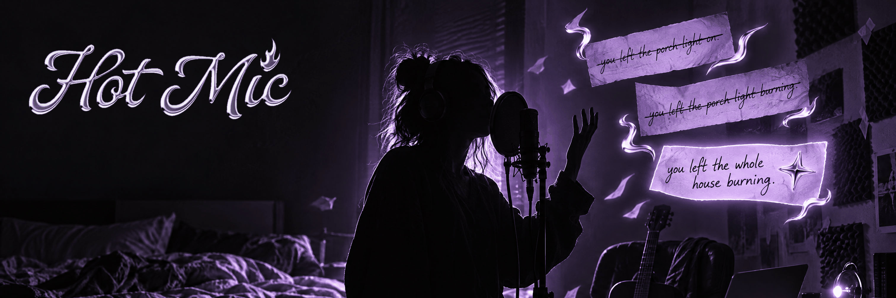

# Hot Mic

**Sing. Don't stop to write it down.**

A Mac app by blue gum that records your whole songwriting session and turns it into a notepad of everything you sang, hummed or rapped, every version of every line, with the exact moment you sang it one click away. Audio stays on your Mac.

**Want the real story?** [ESSENCE.md](ESSENCE.md) is the one-pager. [EVOLUTION.md](EVOLUTION.md) is every round, including the night every recording came out at 557 bytes.

## What it is

You turn it on and start jamming. It keeps the whole session on disk, cuts your ideas into takes, writes down the words line by line, and groups the different ways you sang a line as versions. Star your keeper. If there's a guitar in the room, you get chords and a key. If there's a beat, drop it in and go take after take.

## Why I made it

Every time I started jamming I'd open Voice Memos, go for an hour, and end up with a dead file.

> "When I do a voice memo, I don't have an organized transcript of what I've come up with."

> "I turn on a voice memo and I just go for like an hour, and then if I want to like dig for a part that maybe was cool or hear some other ways that I might have done something alternatively, like scrub through the whole thing. That's really annoying."

The good stuff gets lost, and stopping to grab a pen kills the thing you were chasing. So: a menu bar app that's just on, that keeps everything, and that knows when you're singing. Now I use it instead of Voice Memos any time I'm about to jam on a song.

## Try it

You need a Mac on macOS 14.2 or newer and Xcode with Swift 6. There's no download to grab yet, so you build it yourself.

```bash
git clone https://github.com/fidgetcoding/hotmic-main.git
cd hotmic-main
./scripts/install.sh
```

Heads up on what that script does: it builds a release, **replaces `/Applications/Hot Mic.app`**, pins the app to your Dock, and opens it. If Hot Mic is already running, it waits up to two minutes for it to finish the session's files and quit, and if it's still going after that, it stops and replaces nothing.

Then:

1. **Allow the microphone** when macOS asks.
2. **Hit record** (or press R) and sing, rap, mumble, whatever. Press stop when you're done.
3. **Watch the notepad fill in.** Click a word to jump to that spot in the recording. The first transcription downloads the Whisper model, about 1.6 GB, once, into `~/Library/Application Support/Hot Mic/Models`.
4. **Got an old voice memo?** Drop it on the window and it becomes a session.
5. **Got a beat?** Switch from **Freestyle** to **Beat** and drop it in.

Three things that'll trip you up:

- **Use a real mic, not AirPods.** Bluetooth mics filter out hums and drop into call quality. The app warns you.
- **The first session after a rebuild can record nothing,** because the ad-hoc signature changes and macOS asks for the mic again. To keep the permission, set `HOTMIC_SIGN_ID` to a local signing identity.
- **Lyrics are a draft, not a transcript.**

Your sessions live in `~/Music/Hot Mic/Sessions`.

### Check it without singing (for you or your agent)

These are the checks CI runs on every push. None of them open the app:

```bash
swift build --force-resolved-versions
swift test --force-resolved-versions
npm ci --prefix Tests/lab --ignore-scripts && node --test Tests/lab/*.test.mjs
```

The tests that use the real mic, Whisper, the network or local files are switched off unless you set their `HM_*` variables (the real mic one is `HM_LIVE=1`). CI sets none of them, and you shouldn't either on a Mac someone's making music on.

`./scripts/verify-clean.sh` goes further: it clones the last commit into a temp folder with an empty home folder and a bare PATH, builds the app bundle from the pinned versions, and checks what's inside. It never opens the app and never touches `/Applications`.

## What's in it

- **Whole-session recording.** Once it's on, it's on. Nothing rolls off the end.
- **Takes:** singing, humming, whispers and rap get kept. Silence and noise don't. Two files per take: your voice clean, and your voice with what was playing.
- **The notepad:** live lines while you sing, cleaned up by Whisper line by line, always typeable. Repeats become versions, and a chorus stays a chorus.
- **Freestyle and Beat modes,** with a loop brace that behaves like your DAW's.
- **Music from `playing` takes:** chords, key, BPM and MIDI, with chord shapes for guitar or piano.
- **Echo cancellation** so you can work on speakers, measured at 19.6 dB on a simulated room.
- **DAW detection and bar stamps,** so takes know where they landed. Stamps score within 10 ms on simulated clock streams.
- **A judge after Stop:** an on-device model sorts your lines from your chatter, and a small learner picks up from your corrections, on your Mac. On my test corpus of six livestreamed songwriting sessions it caught 91% of talk and kept 91% of writing. Nothing leaves your Mac. Needs macOS 26 with Apple Intelligence for the model, and falls back to plain rules without it.
- **Saves that fail say so.** If a file is damaged or can't be read, Hot Mic leaves it alone instead of writing over it, tells you the save failed, and puts a paste that didn't save back in the box so you can try again.
- **Phone join, experimental and off by default.** A phone on your local network can sing into the Mac's session. The link is encrypted with the Noise protocol and invites only point at private network addresses. I've only run it against a simulated phone, never a real iPhone. Read [SECURITY.md](SECURITY.md) before you turn it on.

## Where it's at

Of everything I've put out here, Hot Mic is the most in development, and it needs a lot more testing on real songwriting sessions. I started testing it against songs being written live on stream, and I've started bringing it into my own rehearsals.

On November 5, 2026, CI built it and ran 327 Swift tests (7 skipped, 0 failures) plus 44 tests of the real window page. Those run with no mic, no real phone and no model. The November 4 fixes (safer saves, the judge and window updates) haven't been through a live session with a real mic yet.

## Going deeper

- [docs/SPEC.md](docs/SPEC.md) has the design, the line judge and how it was measured, the phone link, and steps to check library audio by hand.
- `bench/` is the benchmark I grade the lyric logic with. The audio and reference lyrics stay local and never go in the repo.
- `lab/` is the window itself: HTML and JS in a web view, plus the design labs it came from.

## License

[MIT](LICENSE). See [Resources/ThirdPartyNotices.txt](Resources/ThirdPartyNotices.txt) for what's bundled, and [SECURITY.md](SECURITY.md) for what's known.
